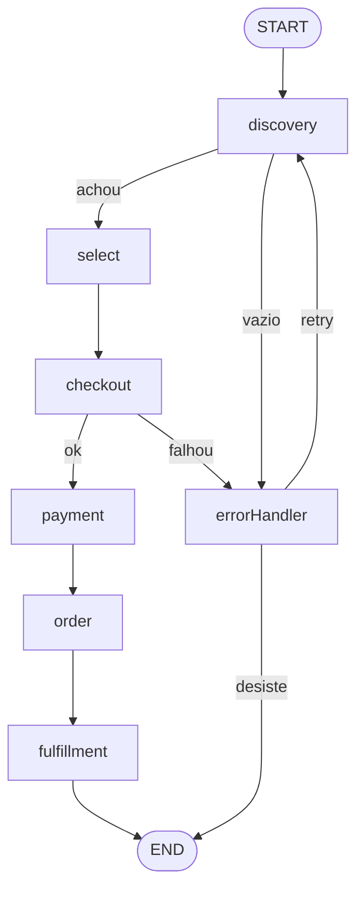

# Plano — Estudo prático: LangGraph + Spring + UCP (Boca Rosa)

> Status: **backend implementado e validado contra a Boca Rosa real** (busca, carrinho, checkout,
> pausa em `payment`, retomada e frete). Falta exercitar os nodes com o LLM DeepSeek real.
> Data: 2026-10-24
> Planos relacionados: frontend em `~/projects/ucp-agent-web/PLANO.md` (chat + grafo de depuração), [PLANO-INFRA.md](PLANO-INFRA.md) (Postgres e deploy).
> Decisão: **POC sem testes unitários ou de integração.** Validação é rodar o fluxo e olhar.

## 1. Objetivo

Entender na prática a máquina de estados do LangGraph rodando em Java/Spring,
usando um fluxo de ecommerce real: **discovery → fulfillment** contra o endpoint
UCP (Universal Commerce Protocol) público da loja Boca Rosa.

Escopo deliberadamente pequeno: 1 módulo Maven, ~20 arquivos, 2 endpoints REST,
sem testes automatizados. Sem banco, sem UI, sem abstração extra.

## 2. Stack (versões verificadas no Maven Central em 2026-10-24)

| Peça | Versão | Observação |
|---|---|---|
| Java | 25.0.2 LTS | já instalado na máquina |
| Spring Boot | 4.1.2 | último stable (4.2.0-RC1 ignorado) |
| Spring AI | 2.0.2 | BOM; langgraph4j compila contra 2.0.1 → compatível |
| langgraph4j | 1.9.7 | `langgraph4j-bom`, `langgraph4j-core`, `langgraph4j-spring-ai` |
| LLM | DeepSeek | `spring-ai-starter-model-deepseek` |
| Build | Maven Wrapper | `mvn` não existe na máquina; wrapper baixado no projeto |

## 3. Descobertas sobre o UCP real (já testado via curl)

**Discovery document:** `https://bocarosa.com.br/.well-known/ucp` → HTTP 200
Versão do protocolo: `2026-08-25`.

**Backend real:** loja Shopify `totvs-sp-boca-rosa.myshopify.com`
**Transporte:** MCP (JSON-RPC 2.0) em `https://totvs-sp-boca-rosa.myshopify.com/api/ucp/mcp`

**Capabilities publicadas:** `shopping.catalog.search`, `shopping.catalog.lookup`,
`shopping.cart`, `shopping.checkout`, `shopping.order`, `shopping.fulfillment`,
`shopping.discount`, `shopping.buyer_consent`

**Tools MCP disponíveis** (`tools/list` responde sem autenticação):

```
search_catalog      lookup_catalog     get_product
create_cart         get_cart           update_cart        cancel_cart
create_checkout     get_checkout       update_checkout
complete_checkout   cancel_checkout
get_order
search_locations    lookup_locations
```

**Formato de preço:** inteiro em unidade menor da moeda + código ISO 4217.
`{"amount": 2500, "currency": "BRL"}` = R$ 25,00. Dividir por 100 antes de exibir.

**Todas as tools exigem** `meta.ucp-agent.profile` = URI do perfil do agente.

## 4. Bloqueios (todos resolvidos)

### 4.1 Agent profile público — RESOLVIDO

O merchant faz fetch server-side do profile e valida o cabeçalho. Tentativas:

| Host | Resultado |
|---|---|
| Gist raw | `profile_malformed: Invalid content type` (serve `text/plain`) |
| GitHub Pages | `profile_malformed: Invalid cache control` (só `max-age`, sem `public`) |
| **jsDelivr sobre repo público** | **funciona** (`application/json`, `public, max-age=604800`) |

Hoje: repo `renanpadilha/ucp-agent-profile`, URL fixada no commit
`ce9c900…` em `application.yml`. Mudar o profile = novo commit + atualizar o hash na URL
(o `@main` fica em cache). O profile precisa declarar `catalog.search`, `catalog.lookup` e
`cart`, senão o merchant responde `Tool not found: search_catalog`.

### 4.2 Chave DeepSeek — RESOLVIDO

Em `application-local.yml` (gitignored, `chmod 600`). Sem chave, `Llm` cai no fallback
determinístico. Recomendada a rotação da chave (ver PLANO-INFRA §6).

### 4.3 Conteúdo do agent profile — RESOLVIDO

Montado pela spec 2026-08-25: `services` (rest, placeholder), `capabilities` e
`payment_handlers: {}`. Ver [agent-profile.json](agent-profile.json).

### 4.4 Frete (descoberto na implementação)

O Shopify só devolve opções de envio depois de `update_checkout` com `buyer.email` e
`fulfillment.methods[].destinations` (incluindo `extended_address`). O cálculo é
**assíncrono**: o client faz polling de `get_checkout`. Dados do comprador são fictícios.

## 5. Limite de segurança (regra fixa do projeto)

`complete_checkout` **cria pedido real e cobrança real** na loja Boca Rosa.

Regra: o node `payment` **nunca** chama `complete_checkout`. Ele monta o payload,
loga, e marca o estado como `PAYMENT_SIMULATED`. O caminho real **não existe no código**
(a flag `allow-real-purchase` foi removida: não ter o caminho é mais seguro que ter flag).

Até onde vai contra a loja real: leitura (`search_catalog`, `get_product`),
`create_cart` e `create_checkout`. Pagamento, não.

## 6. Desenho do grafo

### 6.1 Estado (`OrderState extends AgentState`)

| Chave | Tipo | Escrito por |
|---|---|---|
| `userQuery` | String | entrada |
| `searchFilter` | record estruturado | discovery |
| `candidates` | List\<Product\> (append) | discovery |
| `selectedVariantId` | String | select |
| `cartId` | String | checkout |
| `checkoutId` | String | checkout |
| `shippingOption` | String | fulfillment |
| `status` | enum OrderStatus | todos |
| `error` | String | error handler |
| `retries` | Integer | error handler |

`OrderStatus`: `NEW, DISCOVERED, SELECTED, CHECKOUT_CREATED, PAYMENT_SIMULATED, ORDER_PLACED, FULFILLED, FAILED`

### 6.2 Topologia



7 nodes (6 do fluxo + `errorHandler`). O ciclo `errorHandler → discovery` é o
ponto central do estudo: é o que diferencia LangGraph de um pipeline linear.

### 6.3 Checkpointer e human-in-the-loop

- `MemorySaver` como checkpointer.
- `interruptBefore("payment")` — o grafo **pausa** antes do pagamento.
- Retomada por `thread_id` via segundo endpoint REST.

Isso é o que torna o estudo útil: mostra o grafo persistindo estado entre duas
chamadas HTTP separadas.

## 7. Papel do LLM DeepSeek por node

| Node | O que o LLM faz | Saída |
|---|---|---|
| `discovery` | texto livre → filtro estruturado | structured output → args de `search_catalog` |
| `select` | rerank dos candidatos + justificativa | variantId + motivo em texto |
| `errorHandler` | lê o erro JSON-RPC, decide retry vs desistir | enum `RETRY \| GIVE_UP` + query reformulada |
| `fulfillment` | pesa preço vs prazo nas opções de envio | id da opção escolhida |

`checkout`, `payment` e `order` ficam determinísticos de propósito — serve de
contraste no estudo entre node-com-LLM e node-puro.

## 8. Estrutura de arquivos prevista

```
langgraph/
├── PLANO.md
├── pom.xml
├── mvnw, mvnw.cmd, .mvn/wrapper/
├── agent-profile.json              # o que vai pro gist
└── src/
    ├── main/java/com/example/ucpagent/
    │   ├── UcpAgentApplication.java
    │   ├── graph/
    │   │   ├── OrderState.java
    │   │   ├── OrderStatus.java
    │   │   ├── OrderGraphConfig.java      # monta o StateGraph
    │   │   └── nodes/                      # 7 nodes, 1 arquivo cada
    │   ├── ucp/
    │   │   ├── UcpMcpClient.java           # JSON-RPC sobre RestClient
    │   │   └── UcpModels.java              # records: Product, Cart, Checkout
    │   └── web/
    │       └── OrderController.java        # POST /orders  +  POST /orders/{threadId}/approve
    ├── main/resources/
    │   ├── application.yml
    │   └── ucp-products.json               # fallback mocado
    └── test/java/.../OrderGraphTest.java   # roda o grafo ponta a ponta com LLM fake
```

~12 arquivos de código. Nenhuma interface criada "por via das dúvidas".

## 9. Ordem de execução — andamento

1. [x] Spec do agent profile e `agent-profile.json`.
2. [x] Hospedagem do profile (jsDelivr) e `search_catalog` real validado.
3. [x] Maven Wrapper + `pom.xml` (Boot 4.1.2, Java 25, BOMs).
4. [x] `UcpMcpClient` + records, contra o endpoint real (busca, carrinho, checkout, frete).
5. [x] `OrderState` + `OrderStatus`.
6. [x] Os 7 nodes.
7. [x] `OrderGraphConfig`: edges condicionais, `MemorySaver`, `interruptBefore("payment")`.
8. [x] `OrderController` com os 2 endpoints.
9. ~~Teste JUnit~~ — **cancelado** (POC sem testes).
10. [ ] Rodar com a chave DeepSeek real (chave já em `application-local.yml`).

## 10. Critérios de pronto

- [x] `POST /orders` com `"quero uma base para pele oleosa"` retorna produtos **reais** da Boca Rosa e para no interrupt de pagamento.
- [x] `POST /orders/{threadId}/approve` retoma o mesmo grafo e chega em `FULFILLED`.
- [x] Nenhuma chamada a `complete_checkout` em nenhum caminho de código.
- [ ] Mesmo fluxo com o LLM DeepSeek real nos 4 nodes que o usam.
- [ ] Thread pausada sobrevive a reiniciar o backend (exige checkpointer em banco: PLANO-INFRA).

## 11. Camada para o front (a fazer neste projeto)

O front é outro projeto (`~/projects/ucp-agent-web`). O que este backend precisa expor:

| Item | Detalhe |
|---|---|
| Endpoint **AG-UI** (feito: `POST /sse/order`) | `langgraph4j-ag-ui-springboot` (`AGUISSEController`): eventos `STEP_*`, `STATE_*`, `TEXT_*`, `TOOL_CALL_*`, `RUN_*` |
| Eventos `CUSTOM` | chamadas UCP (tool, ms, ok), chamadas LLM (resumo, ms, `fallback`), decisão das edges |
| `GET /api/graph` | topologia: nós (`llm`/`deterministic`), arestas com rótulo e se são condicionais, `interruptBefore` |
| `threadId` no estado | para os nodes emitirem eventos na thread certa (nodes rodam em threads do `CompletableFuture`) |
| Checkpointer Postgres | `langgraph4j-postgres-saver`, por perfil (ver PLANO-INFRA) |
| Prefixo `/api` | os endpoints atuais `/orders` continuam para `curl` |

**Spike feito e aprovado** (ver `ucp-agent-web/PLANO.md` §3.3). Código em `agui/OrderAgent` e `agui/AguiConfig`. Antes era: grafo mínimo + `AGUISSEController`, para confirmar que os eventos
`STEP_*`/`STATE_*` chegam e que a pausa do `interruptBefore` aparece. Plano B no
`PLANO.md` do front (§3.3).

Estrutura de pastas, deploy e banco: [PLANO-INFRA.md](PLANO-INFRA.md).
